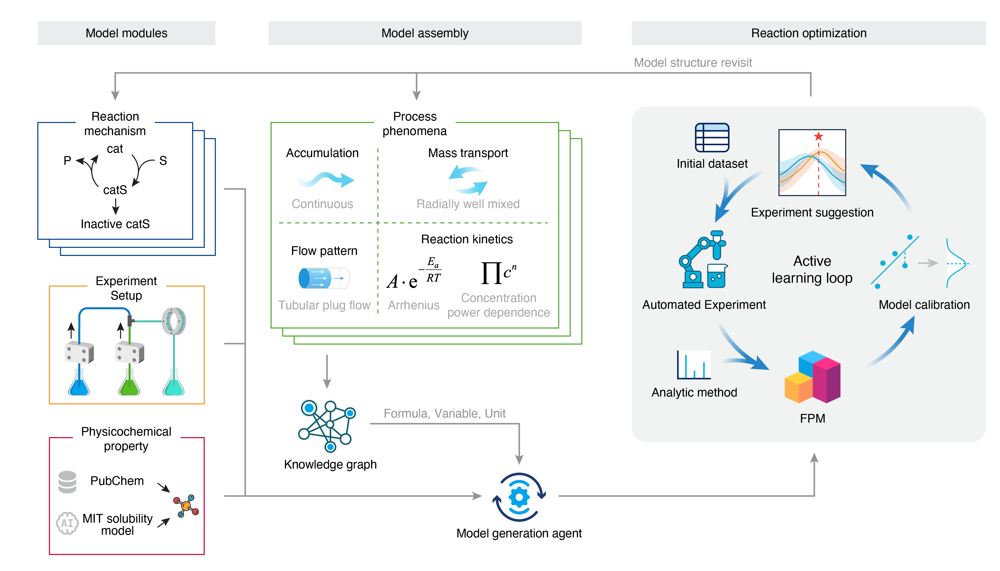

# KIDoE: Knowledge-informed Design of Experiments

  

This repo is a digital platform using first-principles models for reaction optimization. The platform comprises modules for mechanism generation, setup representation, and property acquisition.

We provide an in-silico SNAr (Nucleophilic Aromatic Substituion) reaction case for testing, with the simulator [here](kidoe/benchmark/snar_prld_cstr.py).

To build first-principles models:
1. Infer reaction network: 
`python kidoe/cli.py cases/snar_single_obj chem infer -d 2 -o`
2. Parameterize reaction kinetics: 
`python kidoe/cli.py cases/snar_single_obj chem param -o`
3. Generate candidate reaction networks after fill values in chem_param.yaml:
`python kidoe/cli.py cases/snar_single_obj chem gen -o`
4. Parameterize process model: 
`python kidoe/cli.py cases/snar_single_obj proc param -o`
5. Generate candidate process models after fill values in proc_param.yaml
`python kidoe/cli.py cases/snar_single_obj gen param -o`

Run `python kidoe/cli.py cases/snar_single_obj query all` to get information from [PubChem](https://pubchem.ncbi.nlm.nih.gov) and [MIT solubility prediction model](https://rmg.mit.edu/database/solvation/searchSolubility/)

Run reaction optimization campaign using scripts:
- Single-objective: `python scripts/snar_single_obj.py`
- Multi-objective: `python scripts/snar_multi_obj.py`

Corresponding Gaussian process optimization scripts:
- Single-objective: `python scripts/snar_single_obj_bo.py`
- Multi-objective: `python scripts/snar_multi_obj_bo.py`